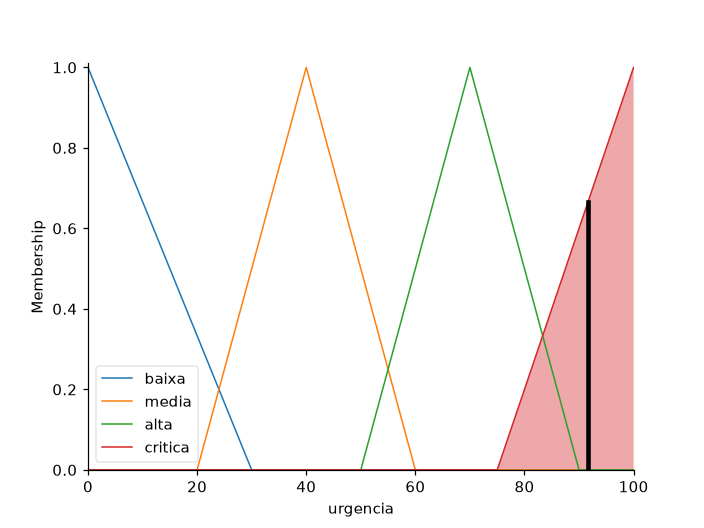
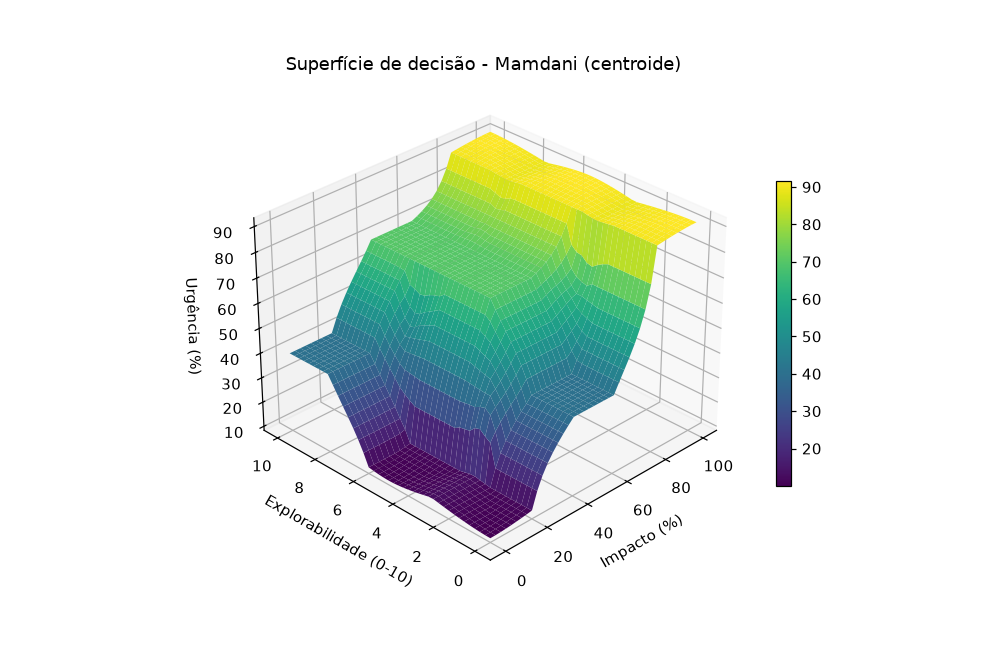

# resultados - aula 10 (AC-3 Sprint 2 - Mamdani e superfície 3D)

Aluno: Matheus Dantas | Turma ECO.8NA | Data: 21/10/2026

Sistema: urgência de correção de um incidente (0 a 100 %) a partir do **Impacto** (0 a 100 %) e da **Explorabilidade** (0 a 10). Código em `lab01_aula10.py` (scikit-fuzzy, Mamdani: E = mínimo, corte das saídas e união pelo máximo).

| Variável | Termo | Função |
|----------|-------|--------|
| Impacto (%) | baixo | triângulo [0, 0, 40] |
| | médio | triângulo [20, 50, 80] |
| | alto | triângulo [60, 100, 100] |
| Explorabilidade (0-10) | baixa | triângulo [0, 0, 4] |
| | moderada | triângulo [2, 5, 8] |
| | alta | triângulo [6, 10, 10] |
| Urgência (%) | baixa | triângulo [0, 0, 30] |
| | média | triângulo [20, 40, 60] |
| | alta | triângulo [50, 70, 90] |
| | crítica | triângulo [75, 100, 100] (na abordagem A: trapézio [75, 90, 100, 100]) |

## a) Desafio dos extremos

Saída do `lab01_aula10.py`:

```
configuração                   (0, 0)    (50, 5)    (60, 6)    (70, 7)  (100, 10)
Centroide + triângulo          10.00%     70.00%     70.00%     75.20%     91.67%
A) Centroide + trapézio        10.00%     70.00%     70.00%     75.20%     90.71%
B) MOM + triângulo              0.00%     70.00%     69.52%     70.85%    100.00%

maior salto na diagonal (passo 2,5% / 0,25):
  Centroide + triângulo       15.81 pontos percentuais
  A) Centroide + trapézio     15.81 pontos percentuais
  B) MOM + triângulo          59.99 pontos percentuais
```



**1. Por que o centroide com triângulos não chega a 0% nem a 100%?**
O centroide é o centro de massa da área agregada. Em (0, 0) só a regra "impacto baixo E explorabilidade baixa" dispara, e a área é o triângulo "baixa" [0, 0, 30]. O centro de massa de um triângulo é a média dos vértices: (0 + 0 + 30) / 3 = 10%. Em (100, 10) só o triângulo "crítica" fica ativo: (75 + 100 + 100) / 3 = 91,67%. Para o centroide dar exatamente 0 ou 100, toda a área teria que estar em cima da borda, e um triângulo sempre tem área para dentro do universo. O 4,33% e o 87,5% do enunciado vêm da mesma conta: 4,33 = (0 + 0 + 13) / 3, que é o triângulo "baixa" [0, 0, 13] do exemplo da gorjeta.

**2. E com trapézio na borda superior da urgência crítica (abordagem A)?**
O resultado em (100, 10) não foi para 100%. Com o trapézio [75, 90, 100, 100] deu 90,71%, até um pouco abaixo do triângulo (91,67%), porque o platô entre 90 e 100 é cheio por igual e a área perto de 75 continua lá. Com o centroide qualquer forma que tenha largura dentro do universo puxa a média para dentro, então o trapézio só aproxima ou afasta, não crava. No meio da escala nada mudou (mesmos valores e o mesmo maior salto, 15,81 p.p.), porque o trapézio só muda a parte de cima da "crítica".

**3. E trocando a defuzzificação para MOM (abordagem B)?**
O MOM é a média dos pontos onde a área agregada é máxima. Nos extremos só há um ponto de máximo, o vértice do triângulo, e ele crava 0% em (0, 0) e 100% em (100, 10). O problema é o meio: o MOM ignora o resto da área, então a saída pula de um termo para o outro quando a regra mais forte muda. Na diagonal o maior salto entre dois pontos vizinhos foi de 59,99 p.p. contra 15,81 p.p. do centroide.

**Qual é mais recomendável?** Nos testes nenhuma das duas fez as duas coisas ao mesmo tempo. A abordagem A mantém a suavidade do centroide no meio da escala, mas não chega a 100%. A B crava os extremos, mas perde a suavidade. Para um sistema de prioridade de incidentes eu ficaria com o centroide (com o trapézio, se a ideia for deixar a urgência crítica num patamar alto e estável), porque uma pequena mudança no impacto não deve fazer a urgência saltar 60 pontos. Se o 100% precisa aparecer no relatório, dá para tratar isso fora do fuzzy, por exemplo exibindo a faixa "crítica" em vez do número.

## b) Matriz de regras 3x3 codificada

| Impacto \ Explorabilidade | Baixa (0-4) | Moderada (2-8) | Alta (6-10) |
|---------------------------|-------------|----------------|-------------|
| Baixo (0-40) | Urgência Baixa | Urgência Baixa | Urgência Média |
| Médio (20-80) | Urgência Média | Urgência Alta | Urgência Alta |
| Alto (60-100) | Urgência Crítica | Urgência Crítica | Urgência Crítica |

No código a matriz é um dicionário `matriz[impacto][explorabilidade]`, e cada célula vira uma regra `SE impacto E explorabilidade ENTÃO urgência`, 9 regras no total. Os termos de cada entrada se sobrepõem e cobrem o universo inteiro, então todo par de entradas dispara pelo menos uma regra. O programa confere isso calculando os 1681 pontos da grade (41 × 41) sem nenhum valor vazio.

## c) Superfície de decisão 3D



```
superfície: 1681 pontos, urgência de 10.00% a 91.67%
```

- A superfície é contínua, sem buracos nem degraus verticais. Isso confirma que a base de regras não tem lacuna de cobertura.
- O impacto pesa mais que a explorabilidade. Com impacto 100 a urgência fica em 91,67% para qualquer explorabilidade (100, 0 e 100, 5 dão o mesmo valor), porque a linha "alto" da matriz é toda "crítica". Com impacto 0 a urgência só sai de 10% quando a explorabilidade fica alta: (0, 10) dá 40%.
- Há platôs onde uma regra domina sozinha: 10% no canto baixo/baixa, 70% em volta de (50, 5) até (50, 10) e 91,67% na faixa de impacto alto.
- Entre os platôs a urgência sobe em rampas, nas faixas onde dois termos se sobrepõem (20 a 40 e 60 a 80 de impacto, 2 a 4 e 6 a 8 de explorabilidade). Exemplos: (30, 3) dá 46,38% e (65, 5) dá 72,09%.
- O piso em 10% e o teto em 91,67% são o efeito do centroide discutido no item a.
